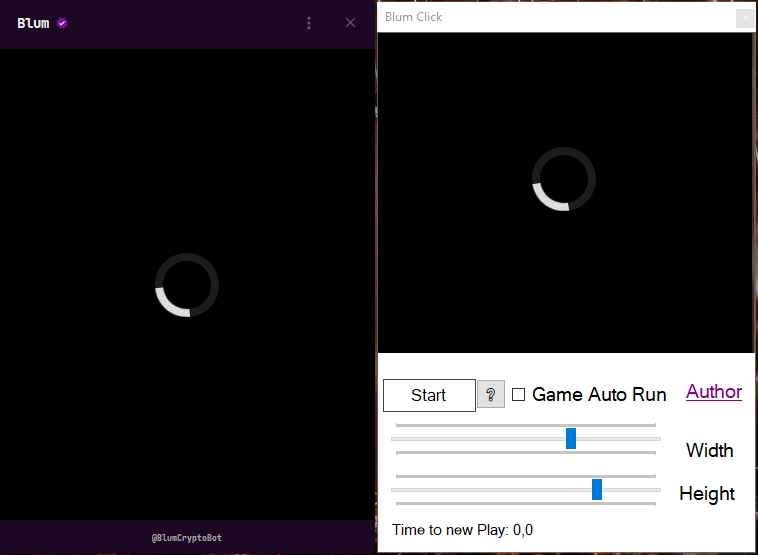

# Blum Auto Clicker

⚡ **Автоматизация игры BLum для достижения лучших результатов**

[Возможности](#-возможности) • [Установка](#-установка) • [Использование](#-использование) • [Скриншоты](#-скриншоты) • [FAQ](#-faq)

---

## 📖 О проекте

**Blum Auto Clicker** — мощный инструмент для автоматизации игрового процесса в **BLum**. Программа имитирует действия мыши, позволяя автоматически выполнять игровые действия и оптимизировать результаты без постоянного ручного управления.

### Почему Blum Auto Clicker?

- 🎯 **Точность** — распознавания пикселей для максимальной эффективности
- 🖥️ **Простота** — интуитивно понятный интерфейс

---

## ✨ Возможности

| Функция | Описание |
|---------|----------|
| ▶️ **Управление ботом** | Запуск и остановка автокликера одним нажатием |
| 🎯 **Захват области** | Настройка зоны для распознавания игровых элементов |
| 🔄 **Авто-рестарт** | Автоматический запуск новой игры после завершения |

---
## 🖼️ Скриншоты

### Главное окно

*Интуитивный интерфейс с простым управлением*

---

## ⚠️ Дисклеймер

> **ВАЖНО:** Использование автоматизации может нарушать правила игры **BLum** и привести к блокировке аккаунта.
>
> - ⚖️ Автор не несет ответственности за последствия использования
> - 🎲 Вы используете программу **на свой страх и риск**
> - 📜 Рекомендуется ознакомиться с правилами игры перед использованием

---

## 🤝 Поддержка и контакты

**Разработчик:** Wixon aka CoderWorker

**© 2024 Wixon aka CoderWorker**

Сделано с ❤️ для сообщества

[⬆ Наверх](#blum-auto-clicker)

